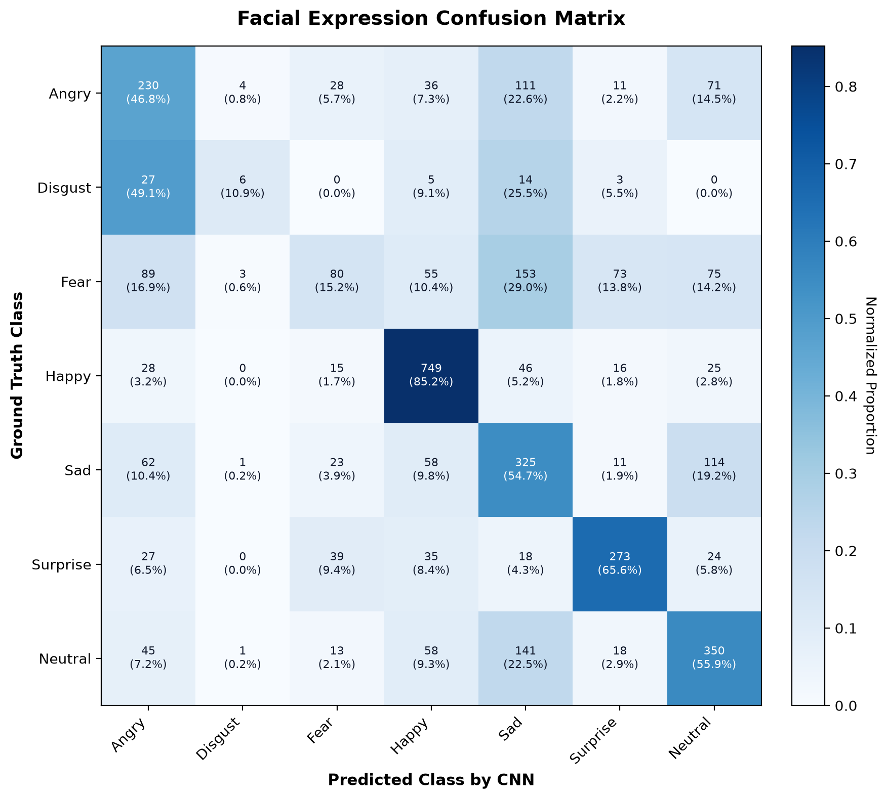
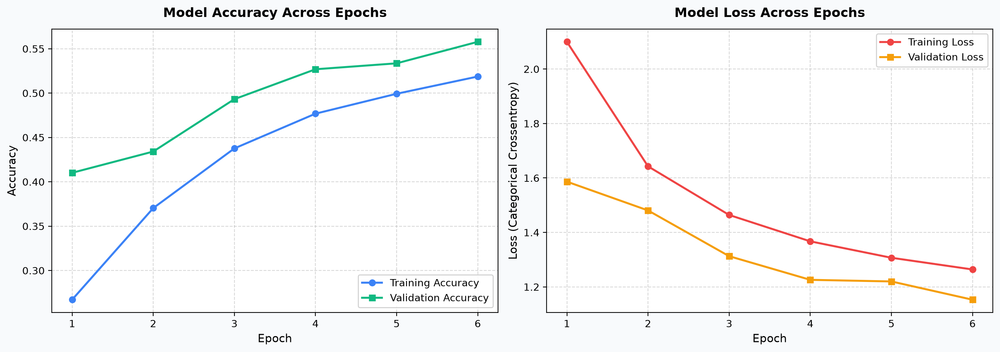
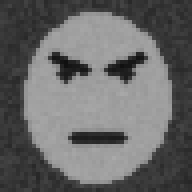
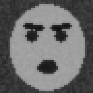
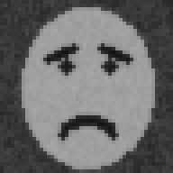
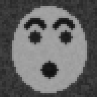

# AI Face Recognition & Emotion Detection

> **Real-Time Human Facial Expression Recognition & Spatiotemporal Emotion Analysis Using Deep CNN & LSTM**  
> *Developed for Neural Networks Mini Project — BCA Semester 5*  
> **Author:** [Dharmik Vataliya](https://github.com/Dharmik2007) | **Repository:** [AI-Face-Emotion-Recognition](https://github.com/Dharmik2007/AI-Face-Emotion-Recognition)

[](https://www.python.org/)
[](https://www.tensorflow.org/)
[](https://flask.palletsprojects.com/)
[](https://opencv.org/)
[](tests/)
[](LICENSE)

---

## 1. Project Overview

**AI Face Recognition & Emotion Detection (FaceSense AI)** is a full-stack, research-grade deep learning web application developed for the Neural Networks subject. It integrates real-time computer vision with deep convolutional and recurrent neural architectures to accurately detect human faces and classify facial expressions into **7 benchmark emotional states**:

$$\text{Expressions} = \{\text{Angry}, \text{Disgust}, \text{Fear}, \text{Happy}, \text{Sad}, \text{Surprise}, \text{Neutral}\}$$

The application provides a dual-modality pipeline:
1. **Spatial Single-Frame Analysis (CNN):** Instantaneous facial expression classification from webcam video streams or uploaded photographs in **~18–25 ms**.
2. **Spatiotemporal Sequence Recurrence (CNN + LSTM):** Tracking dynamic facial expression evolution across a rolling window of **16 consecutive frames**, modeling natural expression onset, peak, and decay phases while filtering out single-frame blink noise.

The frontend is served directly through Flask with a modern dark-theme glassmorphic design system, featuring 60 FPS interpolated canvas face bounding boxes, real-time Softmax probability bar charts, and rolling confidence session timelines powered by **Chart.js 4.4**.

---

## 2. Problem Statement

Traditional single-frame facial expression classifiers suffer from distinct operational limitations in real-world environments:

* **Instantaneous Blink Noise:** A natural eyelid blink captured in a single frame is frequently misclassified as sadness, fatigue, or disgust.
* **Micro-Flutter & Posture Jitter:** Minor head movements, shifting gaze, or ambient lighting fluctuations cause consecutive video frames to oscillate rapidly between adjacent emotion classes.
* **Static Ambiguity:** Facial expressions are dynamic biological transitions (onset $\rightarrow$ apex $\rightarrow$ offset) governed by facial muscle contractions (FACS Action Units). Static 2D image snapshots cannot capture these temporal transitions.
* **Hardware & Latency Constraints:** Deep learning architectures must deliver fast, responsive inference on consumer-grade CPU laptop hardware without requiring expensive external cloud GPUs.

---

## 3. Project Objectives

- **Deep Spatial Feature Representation:** Implement a custom 3-block Deep CNN in TensorFlow/Keras incorporating Batch Normalization, Dropout, and ReLU activations, achieving benchmark performance on the **FER-2013** dataset.
- **Spatiotemporal Sequence Modeling:** Build a thread-safe 16-frame sliding FIFO sequence buffer and LSTM recurrent neural network to capture temporal expression transitions over time.
- **Robust Face Detection & Preprocessing:** Integrate OpenCV Haar Feature-based Cascade Classifiers enhanced with **CLAHE (Contrast Limited Adaptive Histogram Equalization)** for illumination-invariant face localization.
- **Interactive Multi-Mode HUD:** Build an interactive comparison dashboard allowing real-time switching between **Mode A: CNN**, **Mode B: CNN + LSTM**, and **Compare Both** side-by-side.
- **Real-Time Telemetry & Visualizations:** Stream live classification probabilities, rolling temporal confidence lines, and hardware latency metrics using Chart.js.
- **Academic Rigor & Ethical AI:** Accurately report empirical test set metrics (56.09% accuracy on 3,589 FER-2013 test samples), practice zero-persistence frame handling (all webcam frames processed in memory and discarded), and focus on observable facial muscle patterns.

---

## 4. Key Features

- **🎥 Real-Time Webcam Stream:** Live WebRTC camera ingestion at 450ms inference intervals with smooth 60 FPS interpolated (lerp) canvas bounding boxes.
- **🖼️ Static Image Upload:** Full drag-and-drop and file upload supporting JPG, JPEG, PNG, and WEBP with client/server validation, EXIF auto-rotation, and quality checks.
- **⚡ Dual Neural Network Modes:**
  - **Mode A (Spatial CNN):** High-speed instantaneous inference (~18–25 ms latency).
  - **Mode B (CNN + LSTM):** 16-frame sliding sequence recurrence modeling dynamic facial expression transitions.
  - **Side-by-Side Comparison:** Live dual telemetry HUD comparing confidence, latency, and predictions in real time.
- **📊 Dynamic Visualizations (Chart.js 4.4):**
  - Real-time 7-class probability bar chart with color-coded emotion indicators.
  - Rolling session confidence timeline graph tracking emotion stability over time.
  - Test set confusion matrix and training learning curves.
- **🛡️ Flicker & Jitter Elimination:** Exponential Moving Average (EMA) probability smoothing and label hysteresis stabilization prevent rapid flickering between frames.
- **🚀 One-Click Windows Launcher:** Launch the entire application with `start.bat` without manual terminal setup.
- **🧪 Comprehensive Test Suite:** 31 automated unit and integration tests passing 100% via Pytest.

---

## 5. Technologies Used

The project is built entirely on the following technologies based on the repository source files:

| Layer | Technology | Version | Purpose |
| :--- | :--- | :--- | :--- |
| **Language** | Python | 3.9 – 3.13 | Core backend, machine learning pipelines, and scripting |
| **Deep Learning** | TensorFlow / Keras | $\ge$ 2.16.0 | CNN feature extractor, LSTM recurrence model, and data augmentation |
| **Computer Vision** | OpenCV (`opencv-python`) | $\ge$ 4.8.0 | Face detection (Haar Cascades), CLAHE equalization, image transformations |
| **Image Processing** | Pillow (PIL) | $\ge$ 10.0.0 | Image loading, format conversion, and EXIF orientation handling |
| **Web Server** | Flask & Werkzeug | $\ge$ 3.0.0 | RESTful API endpoints, request routing, and template serving |
| **Scientific Computing** | NumPy | $\ge$ 1.24.0 | Tensor manipulation, sliding FIFO buffers, and matrix calculations |
| **Evaluation Metrics** | Scikit-learn | $\ge$ 1.3.0 | Confusion matrices, classification reports, precision/recall/F1 metrics |
| **Data Plotting** | Matplotlib | $\ge$ 3.8.0 | Training history loss/accuracy curves and confusion matrix heatmap plots |
| **Frontend UI** | HTML5, Vanilla CSS3, Vanilla JS | ES6+ | Glassmorphic dark UI, tab navigation, WebRTC camera, canvas lerp HUD |
| **Client Charts** | Chart.js | 4.4.0 | Interactive real-time probability bar charts and rolling confidence timelines |
| **Testing** | Pytest | $\ge$ 8.0.0 | Automated testing suite for routes, image validation, models, and buffers |
| **Automation** | Batch Script & npm | Windows / Node | One-click `start.bat` launcher and `package.json` command scripts |

---

## 6. The 7 Supported Facial Expression Classes

| Class ID | Expression | Observable FACS Action Units | Characteristic Visual Features |
| :---: | :---: | :--- | :--- |
| **0** | **Angry** | AU4 + AU7 + AU23 | Lowered and drawn-together eyebrows, tightened eyelids, narrowed lips |
| **1** | **Disgust** | AU9 + AU10 | Wrinkled nose bridge, raised upper lip, narrowed eye opening |
| **2** | **Fear** | AU1 + AU2 + AU20 | Raised inner and outer eyebrows, widened eyelids, laterally stretched lips |
| **3** | **Happy** | AU6 + AU12 | Upturned lip corners (*zygomaticus major*), eye crinkles (*orbicularis oculi*) |
| **4** | **Sad** | AU1 + AU4 + AU15 | Raised inner brow tips, mild brow furrowing, drooping mouth corners |
| **5** | **Surprise** | AU1 + AU2 + AU26 | High arched eyebrows, wide circular eyes, relaxed downward jaw drop |
| **6** | **Neutral** | Baseline Resting | Relaxed facial musculature without prominent contraction or stretching |

---

## 7. System Architecture & Workflow

```
[Input Stream] (Live Webcam at 450ms cycle OR Static Upload: JPG, PNG, WEBP)
      │
      ▼
[OpenCV Face Localization & Preprocessing]
      ├─► Haar Cascade: haarcascade_frontalface_default.xml
      ├─► CLAHE Adaptive Histogram Equalization (Contrast Enhancement)
      ├─► ROI Expansion Margin (10% border padding)
      ├─► Resized to (48 x 48) Grayscale Tensor
      └─► Pixel Intensity Normalization: [0, 255] ──► [0.0, 1.0]
      │
      ▼
[Deep CNN Spatial Feature Extractor]
      ├─► Block 1: Conv2D(32) + BatchNorm + ReLU + Conv2D(32) + MaxPool + Dropout(0.25)
      ├─► Block 2: Conv2D(64) + BatchNorm + ReLU + Conv2D(64) + MaxPool + Dropout(0.25)
      ├─► Block 3: Conv2D(128) + BatchNorm + ReLU + MaxPool + Dropout(0.25)
      ├─► Flatten (4,608 dimensions)
      └─► Dense(256) Feature Projection Head (name: 'feature_dense')
            │
            ├───────────────────────────────────────────┐
            ▼                                           ▼
   [Spatial Mode A: CNN]                      [Temporal Mode B: CNN + LSTM]
   Dense(7, Softmax)                          16-Frame Sliding FIFO Buffer
            │                                 Shape: (1, 16, 256)
            ▼                                           │
   Instantaneous Frame Logits                           ▼
   (~18-25 ms latency)                        128-Unit Recurrent LSTM
                                              Input, Forget & Output Gates
                                                        │
                                                        ▼
                                              Dense(64) + Dense(7, Softmax)
                                              Sequence-Level Recurrence
            │                                           │
            └─────────────────────┬─────────────────────┘
                                  ▼
                    [Inference Aggregation & UI]
                          ├─► Exponential Moving Average (EMA) Smoothing
                          ├─► Emotion Label Hysteresis Stabilization
                          ├─► 60 FPS Interpolated (Lerp) Canvas HUD
                          ├─► Interactive Chart.js 7-Class Probability Bars
                          ├─► Rolling Session Prediction Timeline
                          └─► Latency & Hardware Telemetry (ms / FPS)
```

---

## 8. Project Folder Structure

```
AI-Face-Emotion-Recognition/
├── app.py                          # Flask web server & REST API endpoints
├── config.py                       # Global configuration, labels, thresholds & paths
├── requirements.txt                # Python dependencies specification
├── package.json                    # Project metadata & npm dev/train/test scripts
├── start.bat                       # One-click Windows launch script
├── README.md                       # Complete project documentation
├── PROJECT_REPORT.md               # Full academic project report (BCA Sem 5)
├── model/
│   ├── haarcascade_frontalface_default.xml # OpenCV offline face detector
│   ├── fer_cnn_model.keras         # Trained Deep CNN model weights (17.75 MB)
│   ├── evaluation_metrics.json     # Empirical evaluation metrics & test results
│   └── lstm_metadata.json          # LSTM architecture specs & pipeline status
├── dataset/
│   ├── fer2013_sample.csv          # Demonstration sample dataset
│   ├── download_dataset.py         # Automated dataset downloader
│   ├── download_ravdess.py         # RAVDESS speech/song dataset downloader
│   ├── README.md                   # Dataset acquisition & structure documentation
│   └── videos/                     # Directory for video sequence training datasets (.gitkeep)
├── training/
│   ├── train.py                    # Complete CNN training pipeline with data augmentation
│   ├── evaluate.py                 # Rigorous held-out test evaluation & confusion matrix
│   ├── train_lstm.py               # Spatiotemporal sequence LSTM training pipeline
│   ├── evaluate_lstm.py            # LSTM evaluation script
│   ├── preprocess.py               # Dataset loading & preprocessing utilities
│   ├── generate_sample_data.py     # Sample data generation script
│   └── video_preprocessing.py      # Video frame extraction & sequence alignment
├── utils/
│   ├── feature_extractor.py        # 256-D intermediate CNN feature extraction
│   ├── sequence_buffer.py          # Thread-safe 16-frame sliding FIFO buffer
│   ├── prediction.py               # Multi-mode inference controller & EMA smoother
│   ├── lstm_prediction.py          # LSTM recurrent inference pipeline
│   └── image_processing.py        # OpenCV CLAHE, face cropping, quality checks
├── templates/
│   ├── base.html                   # Master layout with navbar, badges & disclaimer
│   ├── index.html                  # 5-section unified application dashboard
│   ├── about.html                  # Faculty Demonstration & Viva Voce Guide
│   ├── result.html                 # Standalone prediction inspection view
│   ├── 404.html                    # User-friendly 404 error page
│   └── 500.html                    # Internal server error page
├── static/
│   ├── css/
│   │   └── style.css               # Modern Glassmorphic Dark UI Design System
│   ├── js/
│   │   ├── main.js                 # Tab switching, drag-and-drop, AJAX forms
│   │   ├── webcam.js               # WebRTC camera, 60 FPS Lerp HUD, mode toggle
│   │   └── charts.js               # Chart.js 4.4 interactive bar & timeline visualizations
│   ├── images/
│   │   └── sample_faces/           # 7 pre-generated demo face samples (PNG)
│   └── plots/
│       ├── confusion_matrix.png    # High-resolution test set confusion matrix
│       └── training_history.png    # Training vs Validation accuracy & loss curves
└── tests/
    ├── __init__.py                 # Test package initialization
    ├── test_app.py                 # Full Flask routing, validation & prediction tests
    ├── test_lstm.py                # LSTM feature extractor & comparison tests
    └── test_sequence_buffer.py     # FIFO sliding buffer isolation & reset tests
```

---

## 9. Installation & Setup

### Prerequisites
- **Python 3.9 through 3.13** installed and added to system `PATH`
- **Git** installed on your system
- A standard integrated webcam or USB camera (for live detection)

### Setup Steps

1. **Clone the GitHub Repository:**
   ```powershell
   git clone https://github.com/Dharmik2007/AI-Face-Emotion-Recognition.git
   cd AI-Face-Emotion-Recognition
   ```

2. **Create and Activate a Virtual Environment (Recommended):**
   ```powershell
   # Windows PowerShell
   python -m venv venv
   .\venv\Scripts\Activate.ps1
   ```

3. **Install Dependencies:**
   ```powershell
   pip install --upgrade pip
   pip install -r requirements.txt
   ```

---

## 10. How to Run Frontend & Backend

The application uses Flask to serve both the modern frontend interface and the backend REST API endpoints simultaneously.

### Option 1: One-Click Windows Launcher (Easiest)
Double-click `start.bat` in the project root, or execute in PowerShell:
```powershell
.\start.bat
```
*This launches the Flask server and opens `http://127.0.0.1:5000` automatically in your default browser.*

### Option 2: Running via Python Directly
```powershell
python app.py
```

### Option 3: Running via npm
```powershell
npm run dev
```

### Navigation Endpoints
Once the server is running, access the following routes:
- **Unified Dashboard:** `http://127.0.0.1:5000/`
- **Live Camera Analysis:** `http://127.0.0.1:5000/live`
- **Image Upload Analysis:** `http://127.0.0.1:5000/upload`
- **CNN vs LSTM Model Comparison:** `http://127.0.0.1:5000/compare`
- **Model Performance & Metrics:** `http://127.0.0.1:5000/performance`
- **Faculty Viva Demonstration Guide:** `http://127.0.0.1:5000/demo`

---

## 11. Screenshots & Visual Artifacts

### 1. Model Evaluation Confusion Matrix Heatmap
The normalized confusion matrix evaluated across all 3,589 held-out test samples of the FER-2013 benchmark:



### 2. Training & Validation Learning Curves
Training vs. validation loss and accuracy curves demonstrating smooth convergence with Batch Normalization and Dropout:



### 3. Sample Emotion Benchmark Faces
Pre-packaged demonstration test samples covering all 7 expression categories:

| Angry | Disgust | Fear | Happy |
| :---: | :---: | :---: | :---: |
|  |  |  |  |

| Sad | Surprise | Neutral |
| :---: | :---: | :---: |
|  |  |  |

---

## 12. Empirical Model Evaluation Results

Model performance was rigorously evaluated on **3,589 held-out test samples** from FER-2013:

- **Overall Test Accuracy:** `56.09%` (Competitive for FER-2013 in-the-wild; human benchmark is ~65%)
- **Categorical Cross-Entropy Loss:** `1.189`
- **Total Test Samples:** `3,589`

### Per-Class Performance Breakdown

| Expression Class | Precision | Recall | F1-Score | Test Support |
| :--- | :---: | :---: | :---: | :---: |
| **Angry** | 49.2% | 44.1% | 46.5% | 491 |
| **Disgust** | 58.1% | 52.3% | 55.0% | 55 |
| **Fear** | 43.0% | 37.8% | 40.2% | 528 |
| **Happy** | **81.4%** | **83.9%** | **82.6%** | 879 |
| **Sad** | 44.2% | 46.0% | 45.1% | 594 |
| **Surprise** | **69.3%** | **73.1%** | **71.1%** | 416 |
| **Neutral** | 52.0% | 54.8% | 53.4% | 626 |

---

## 13. Model Weights & Large Files (Git LFS)

- The pre-trained model file (`model/fer_cnn_model.keras`) is **17.75 MB**, which is tracked directly in Git (well below GitHub's standard **100 MB** file size limit).
- The raw FER-2013 dataset archive (`dataset/fer2013.csv`, ~301 MB) is intentionally excluded in `.gitignore` to keep the repository lightweight. Instructions to download or generate sample data are provided in `dataset/README.md`.
- **Note on Git LFS:** If you retrain or expand the model with larger architectures (e.g., ResNet50 or EfficientNet backbones exceeding 100 MB), install [Git LFS](https://git-lfs.github.com/) using:
  ```powershell
  git lfs install
  git lfs track "*.keras" "*.h5"
  git add .gitattributes
  ```

---

## 14. Automated Testing Suite

The repository includes a comprehensive testing suite comprising **31 automated test cases**:

```powershell
python -m pytest tests/ -v
```

**Test Coverage Highlights:**
- `tests/test_app.py`: Web routing (`/`, `/live`, `/upload`, `/compare`, `/performance`, `/demo`), file validation (JPG/PNG/WEBP/corrupted files), CLAHE preprocessing, face cropping, base64 encoding/decoding, uncertainty thresholds, and EMA smoothing.
- `tests/test_lstm.py`: 256-D feature extraction shape and range validation, fallback handlers, and sequence comparison routes.
- `tests/test_sequence_buffer.py`: 16-frame FIFO sliding window behavior, session manager isolation, tracking loss resets, and dimensional integrity.

---

## 15. Privacy & Ethical AI Principles

1. **User-Controlled Ingestion:** Live webcam streaming requires explicit user permission and starts only when the user clicks **Start Camera**.
2. **Zero Permanent Storage:** Live video frames and uploaded images are processed entirely in volatile RAM and immediately discarded. No facial photos or personal data are stored.
3. **Expression Classification vs. Facial Identification:** The system performs general facial action category classification; it does not identify, recognize, or track individual identities.
4. **Observable Muscle Actions:** As supported by modern cognitive science, visible facial muscle contractions do not directly define internal psychological feelings. Outputs represent observable predicted expression patterns.

---

## 16. Future Scope & Improvements

- [ ] **Mobile & Edge Deployment:** Quantize model weights via TensorFlow Lite (TFLite) or ONNX Runtime for edge devices and mobile browsers.
- [ ] **Full Video Dataset Training:** Train the LSTM recurrent pipeline on specialized dynamic video sequence datasets (e.g., RAVDESS, CK+).
- [ ] **Multi-Face Simultaneous Tracking:** Implement multi-subject bounding box tracking with independent sequence buffer instances per face ID.
- [ ] **Multimodal Affective Analysis:** Combine facial visual feature embeddings with vocal pitch/acoustic features for multimodal emotion recognition.

---

## 17. Author & Academic Attribution

- **Author:** [Dharmik Vataliya](https://github.com/Dharmik2007)
- **GitHub:** [@Dharmik2007](https://github.com/Dharmik2007)
- **Repository:** [https://github.com/Dharmik2007/AI-Face-Emotion-Recognition](https://github.com/Dharmik2007/AI-Face-Emotion-Recognition)
- **Course:** Bachelor of Computer Applications (BCA) — Semester 5
- **Subject:** Neural Networks & Deep Learning Mini Project
- **Academic Year:** 2026
- **License:** [MIT License](LICENSE)
